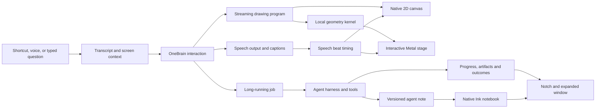

# HeyClicky 1.1.3 architecture research

**The 3D figures are generated as code and rendered locally.** A model writes a drawing program. The app interprets it, generates mesh parts locally using its own recipe layer over Three.js, then renders them in a native Metal stage. Speech and drawing share a beat timeline. The notebook-style interface is a separate system called Ink. It turns evolving agent notes into structured, animated pages.

| Read | Covers |
| --- | --- |
| [UI, notch, and windows](01-ui-and-notch.md) | AppKit panels, SwiftUI state, per-display windows, hover scheduling, chat and artifact presentation |
| [Voice and models](02-voice-and-models.md) | Push-to-talk, always-on, warmed transcription, OneBrain, speech output, model IDs and measurement |
| [Agents and computer use](03-agents-and-computer-use.md) | Job lifecycle, execution harness, workspace, permissions, Mac control and Chrome |
| [Drawing, 3D, and narration](04-drawing-3d-and-narration.md) | Streaming model programs, Core Animation, geometry generation, Metal, interaction, replay |
| [Ink notebooks and live writing](05-ink-notebooks.md) | Note versions, structured blocks, pages, pen animation, interactivity and its relationship to speech |
| [Evidence and open questions](06-evidence.md) | Build fingerprint, source anchors, confidence and reproducibility |

## System map

The diagram combines confirmed component boundaries and inferred call order. It does not assert that every voice turn takes the OneBrain path, that all jobs produce an Ink document, or that Ink and speech use a common clock.

## What maps to Calshot

- **Synchronized explanations.** Start with a small, declarative stream of narration beats and 2D marks. Use the audio playback clock to reveal the appropriate mark. Tie screen-relative marks to the frame and display that produced them, and clear or re-anchor when that context changes. Calshot already has a frame composer and native playback accounting. [Frame composer](../../../Sources/Voice/FocusFrameComposer.swift) · [Voice audio engine](../../../Sources/Voice/VoiceAudioEngine.swift)
- **Evolving documents.** Treat a structured artifact as durable content and render revisions in the workspace. Animate only the changed rows or blocks, with reduced motion and a readable final state. This can work independently of speech and drawing.
- **Voice-to-agent handoff.** Keep the same native run, show progress in the conversation, and speak verified results. Calshot's GPT-Live route already delegates through its native agent. Its grants, reviews, receipts and Undo define the action boundary. [Calshot agent architecture](../../AGENT_ARCHITECTURE.md)
- **Audio and input timing.** Measure the path independently from press to signal, transcript, request, first output, and audible speech. Distinguish an unavailable input device from an empty transcript or a playback failure.

Scope is the installed signed macOS app, version **1.1.3 build 71**. The app's resources and arm64 metadata were inspected. Published demos and release notes corroborate visible behavior. The app was not opened, and no live account, model request, desktop action, or browser action was tested. No product code changed.
